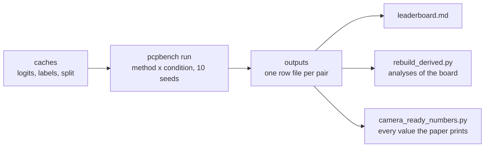

# pcpbench

**Per-class conformal coverage under distribution shift, measured on one locked protocol.**

[](https://doi.org/10.5281/zenodo.24203939)
[](LICENSE)


Conformal prediction guarantees coverage on average. Under distribution shift, single classes
can fall far below the target while the average holds. pcpbench measures that failure with one
cache format, one locked protocol, five coverage and efficiency metrics, and an efficiency guard
that demotes near-full prediction sets. A new method yields a row that compares directly with
the released ones.

Code and results of the KDD 2027 Datasets and Benchmarks paper *pcpbench: A Benchmark for
Per-Class Conformal Coverage under Distribution Shift*.

## At a glance

| What | Detail |
| --- | --- |
| **175 conditions** | CIFAR-10-C, CIFAR-100-C and ImageNet-1k corruptions, two skeleton action shifts |
| **7 methods** | split, Source-Mondrian, weighted, PPI, ACP, held-out oracle, clustered |
| **5 metrics** | marginal coverage, worst-class coverage, share of undercovered classes, share significantly undercovered, mean set size |
| **492-row headline** | six methods on the 82 ViT-B/32 and CTR-GCN conditions |
| **Every number re-checkable** | two `--check` commands rebuild the board, the analyses and every value the paper prints |

## The board

| Family | Conditions | K | Backbone |
| --- | --- | --- | --- |
| CIFAR-10-C | 80: 8 corruptions x 5 severities on each backbone | 10 | OpenCLIP ViT-B/32, ViT-L/14 |
| CIFAR-100-C | 83: the same 80, plus 3 legacy caches | 100 | OpenCLIP ViT-B/32, ViT-L/14 |
| ImageNet-1k | 10 | 1000 | OpenCLIP ViT-B/32, ViT-L/14 |
| NTU-60 cross-subject, NTU-60 to N-UCLA | 2 | 60, 5 | CTR-GCN |

[`leaderboard.md`](leaderboard.md) is the full board, and [`leaderboard_aps.md`](leaderboard_aps.md)
reruns the methods under the APS score. Composition, provenance and licenses of every family:
[`docs/DATASHEET.md`](docs/DATASHEET.md).



## Quick start

```bash
git clone https://github.com/Vivianmxmf/pcpbench.git
cd pcpbench
pip install -e .
pcpbench run --dataset synthetic --method mondrian --seeds 5
```

The last command scores Source-Mondrian on a built-in synthetic shift and prints one JSON row.
Python 3.10 to 3.12 with numpy, scipy and scikit-learn. Flags, the Python API and the cache
format: [`docs/quickstart.md`](docs/quickstart.md).

## Reproduce the paper

No cache needed. From the repository root:

```bash
pip install -e ".[dev]"
python -m pytest -q
python scripts/rebuild_derived.py --check
python scripts/camera_ready_numbers.py --check
```

`rebuild_derived.py` rebuilds the board and every analysis from the committed row files.
`camera_ready_numbers.py` writes every measured value and table body of the paper into
`paper/camera_ready/generated/`. With `--check`, each compares a fresh run with the committed
files. Appendix D of the paper lists the changes from the reviewed version.

The paper and this repository name some things differently:

| Paper | Repository |
| --- | --- |
| matched reference | validity floor: `pcpbench.metrics.validity_floor`, keys `floor.*` |
| large-set rule, flagged row | efficiency guard, row demoted below the divider of the board |
| target oracle | `oracle` |
| normalized prediction-set size | `set/K` |
| fraction of classes below the nominal level | `frac_undercovered` |
| class-count study | controlled K sweep, `scripts/controlled_k_sweep.py` |
| nested study | nested K sweep, `outputs/nested_ksweep/` |
| target-label budget | label sweep, `scripts/label_complexity_sweep.py` |
| condition and backbone pair | one cache |
| five selected conditions | the moderate caches |
| rows with low marginal coverage | regime B, `regime_b` |

## Run on the caches

The 175 caches are archived on Zenodo as `pcpbench-1.0.0-caches.tar`
([doi:10.5281/zenodo.24203939](https://doi.org/10.5281/zenodo.24203939)). At the repository root:

```bash
tar -xf pcpbench-1.0.0-caches.tar
bash scripts/run_grid.sh
```

The tar fills `caches/`. `run_grid.sh` runs every method on every cache and rebuilds the board
from the row files under `outputs/`. The Slurm job, the thread count that reproduces the
released rows, and the command that keeps the released board's conditions are in section 7 of
[`docs/quickstart.md`](docs/quickstart.md).

## Add a method

A method is a class whose `fit` returns an object with `predict_set`, a boolean `[N, K]` mask.
Registered in `METHODS`, it runs like the built-in ones:

```python
import numpy as np

from pcpbench.datasets.synthetic import make_synthetic_shift
from pcpbench.runner import METHODS, run


class FittedTopClass:
    def predict_set(self, logits):
        mask = np.zeros(logits.shape, dtype=bool)
        mask[np.arange(len(logits)), logits.argmax(axis=1)] = True
        return mask


class TopClass:
    def fit(self, cal_logits, cal_labels, *, alpha=0.1, seed=0):
        return FittedTopClass()


METHODS["topclass"] = TopClass
ds = make_synthetic_shift(K=8, n_per_class=500, shift=0.6, seed=0)
row = run(ds, "topclass", alpha=0.1, seeds=5)
print(row["worst_class"], row["mean_set_size"])
```

Add the entry to `METHODS` in `src/pcpbench/runner.py` to run it as
`pcpbench run --method topclass`.

## Repository layout

| Path | Contents |
| --- | --- |
| `src/pcpbench/` | library: methods, scores, metrics, cache loader, runner, command line |
| `scripts/` | cache builders, grid launchers, analyses, paper numbers |
| `outputs/` | per-row results behind both boards, analysis files |
| `paper/camera_ready/generated/` | every value and table body the paper prints |
| `docs/` | quickstart, datasheet, related work, ImageNet-1k launch notes |
| `tests/` | library, sweeps, analyses, paper numbers |

## Citation

```bibtex
@inproceedings{han2027pcpbench,
  title     = {pcpbench: A Benchmark for Per-Class Conformal Coverage under Distribution Shift},
  author    = {Han, Weijia and Qu, Lisha},
  booktitle = {Proceedings of the 33rd ACM SIGKDD Conference on Knowledge Discovery and Data Mining V.1 (KDD '27)},
  year      = {2027},
  publisher = {ACM},
  address   = {New York, NY, USA},
  doi       = {10.1145/3862868.3871551}
}
```

Archived release: [doi:10.5281/zenodo.24203939](https://doi.org/10.5281/zenodo.24203939).

## License

Code, per-row outputs and analysis files: MIT ([`LICENSE`](LICENSE)). Each upstream dataset
keeps its own license and terms of access, and those of ImageNet-1k apply to its ten caches.
